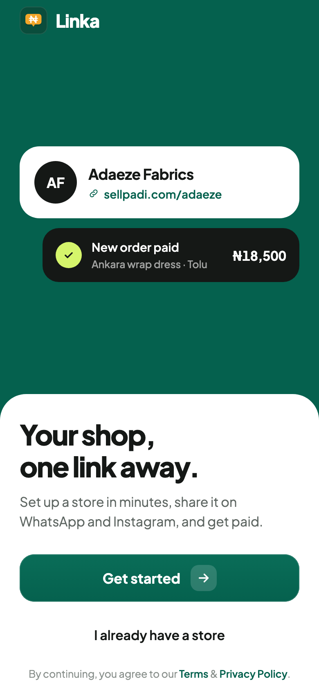
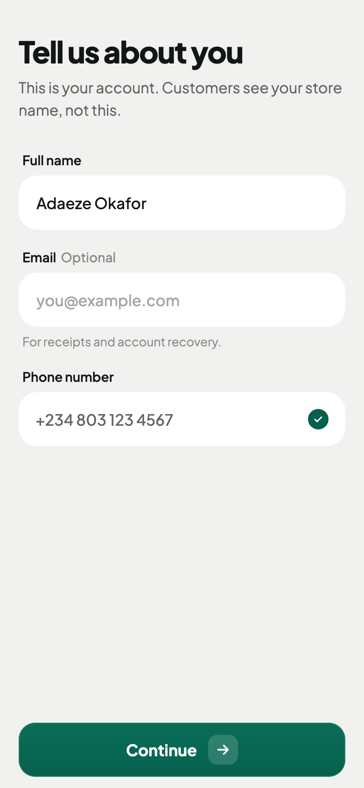
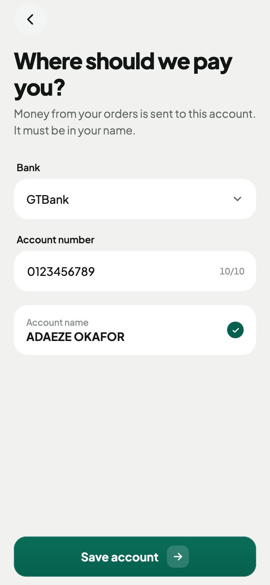
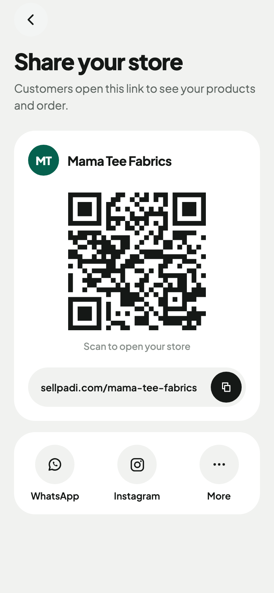

# Linka

Linka is a mobile app for Nigerian vendors who sell on WhatsApp and Instagram. A vendor signs up with their phone number, sets up a store, adds products, and gets one link to share with customers.

Built with Expo and React Native. Runs on iOS, Android, and web.

<p>
  
  
  
  
</p>

## Status

The app is in active development. The vendor side is mostly built; there is no backend yet, so data is saved on the device.

| Area | Screens | State |
| --- | --- | --- |
| Onboarding | Welcome, phone number, OTP, profile | Built. OTP accepts any 6-digit code until SMS is connected. |
| Store | Store setup, store preview | Built |
| Payouts | Payout account, BVN/NIN check | Built. Account name lookup is stubbed. |
| Dashboard | Stats, quick actions, recent orders | Built with sample data |
| Products | List, add/edit, bulk add from photos, details | Built. AI product suggestions are simulated. |
| Sharing | QR code, copy link, WhatsApp, Instagram | Built |
| Orders | Orders list, order details | Not started |
| Account | Notifications, settings | Not started |

## Tech stack

- [Expo](https://expo.dev) SDK 57 and React Native 0.86
- [Expo Router](https://docs.expo.dev/router/introduction/) for file-based navigation
- TypeScript
- React Native Reanimated for animation
- `expo-sqlite` key-value store for on-device data (`localStorage` on web)
- `react-native-svg` and `react-native-qrcode-svg` for icons and QR codes
- Plus Jakarta Sans

## Getting started

You need Node.js 20 or later and npm.

```bash
git clone <repo-url>
cd Linka
npm install
npx expo start
```

From the Expo CLI, press `i` for the iOS simulator, `a` for an Android emulator, or `w` for the browser.

Some features (camera, image picker, haptics) need a [development build](https://docs.expo.dev/develop/development-builds/introduction/) rather than Expo Go:

```bash
npx expo run:ios
npx expo run:android
```

## Scripts

| Command | What it does |
| --- | --- |
| `npx expo start` | Start the dev server |
| `npm run ios` | Build and run on iOS |
| `npm run android` | Build and run on Android |
| `npm run web` | Run in the browser |
| `npx expo lint` | Lint |
| `npx tsc --noEmit` | Type-check |

Add packages with `npx expo install <package>` so versions match the Expo SDK.

## Project structure

```text
src/
  app/          Screens. Each file is a route (Expo Router).
  components/   UI grouped by feature: auth, dashboard, payout, products, store
  state/        On-device stores: store profile, vendor profile, payout, products
  constants/    Theme colours and fonts
  utils/        Money, phone, and slug formatting
assets/         Images and illustrations
```

### Sign-up flow

```text
welcome → phone number → OTP → profile → store setup → payout → store preview → dashboard
```

Returning vendors with a saved store open straight to the dashboard.

## Connecting a backend

These pieces are placeholders and need a server:

- **OTP**: `src/app/verify.tsx` accepts any code. Send and check codes through an SMS provider.
- **Account name lookup**: `resolveAccountName` in `src/state/payout.ts` returns the vendor's profile name. Replace it with a call to your server, which calls a bank resolve endpoint (for example Paystack). Don't call that endpoint from the app, because it needs a secret key.
- **Data**: everything in `src/state/` is saved on the device. Each store exposes the same small API (`save`, `get`, `use`), so it can be swapped for API calls.

## Roadmap

- Orders list and order details
- Notifications
- Settings (edit profile, payout account, store)
- Backend: auth, products, orders, payments
- Customer-facing storefront

## License

MIT. See [LICENSE](LICENSE).
